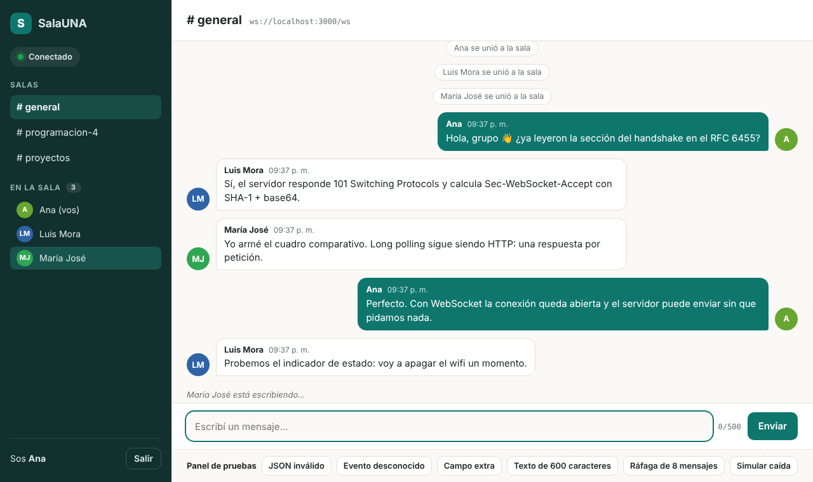

# SalaUNA · Chat en tiempo real con WebSockets

Aplicación cliente–servidor que demuestra **comunicación bidireccional en tiempo real** usando el protocolo **WebSocket (RFC 6455)**.
Proyecto de la tarea de investigación de **Programación 4**, Escuela de Informática, Universidad Nacional.

- **Servidor:** Node.js + [`ws`](https://github.com/websockets/ws) (implementación de RFC 6455), sin frameworks extra.
- **Cliente:** HTML + CSS + JavaScript con la **API `WebSocket` nativa** del navegador.
- **Mensajes:** JSON con el esquema `{ "event": "...", "data": { ... } }`, validados en el cliente y en el servidor.



---

## Funcionalidades

| Funcionalidad | Dónde está |
|---|---|
| Conexión WebSocket real (`ws://` o `wss://`) y manejo de apertura y cierre | `public/js/socket-client.js`, `src/chatServer.js` |
| Salas (`general`, `programacion-4`, `proyectos`) con cambio de sala | `src/rooms.js` |
| Mensajes en tiempo real retransmitidos (*broadcast*) a la sala | `src/chatServer.js` |
| Lista de usuarios conectados y aviso de entrada y salida | eventos `room:users`, `user:join`, `user:leave` |
| Indicador "está escribiendo…" | evento `user:typing` |
| Historial de los últimos 50 mensajes por sala (en memoria) | evento `chat:history` |
| **Indicador de estado:** conectado, conectando, reconectando o desconectado | `public/js/app.js` → `renderStatus` |
| **Reconexión automática** con retroceso exponencial y reanudación de sesión | `RealtimeSocket._scheduleReconnect`, `resumeToken` |
| **Validación** del esquema en cliente y servidor, con errores tipados | `src/protocol.js` |
| Seguridad: validación de `Origin`, límite de tamaño (4 KB), límite de frecuencia, límite de conexiones por IP, *heartbeat* ping/pong, CSP, escape de HTML | `src/config.js`, `src/chatServer.js`, `src/server.js` |
| Soporte opcional de TLS (`wss://`) | variables `TLS_CERT` y `TLS_KEY` |
| 18 pruebas automáticas (unitarias y de integración) | `test/` |

---

## Requisitos

- **Node.js 18 o superior** (probado con Node 22). Se verifica con `node -v`.
- **npm** (viene con Node).
- Un navegador moderno: Chrome, Edge o Firefox.

## Instalación y ejecución

```bash
git clone https://github.com/Progra4-2026/Chat-Websockets-Tarea-de-investigaci-n.git
cd Chat-Websockets-Tarea-de-investigaci-n
npm install
npm start
```

Luego abrí **http://localhost:3000** en el navegador. Para simular varios usuarios, abrí la misma dirección en otra pestaña, en una ventana de incógnito o en otro navegador.

La consola del servidor muestra:

```
──────────────────────────────────────────────
 SalaUNA · chat en tiempo real con WebSockets
 Cliente:   http://localhost:3000
 Endpoint:  ws://localhost:3000/ws
 Orígenes permitidos: http://localhost:3000, http://127.0.0.1:3000
──────────────────────────────────────────────
```

### Otros comandos

| Comando | Qué hace |
|---|---|
| `npm test` | Ejecuta las 18 pruebas automáticas (`node --test`). |
| `npm run dev` | Arranca el servidor y lo reinicia al guardar cambios. |
| `PORT=4000 npm start` | Usa otro puerto (en Windows PowerShell: `$env:PORT=4000; npm start`). |

### Panel de pruebas

Abrí **http://localhost:3000/?debug=1** para ver un panel que envía a propósito mensajes inválidos: JSON roto, evento desconocido, campo extra, texto de 600 caracteres y ráfaga de 8 mensajes. También tiene un botón que simula una caída de la conexión. Sirve para verificar la validación y la reconexión.

### Probar desde otro dispositivo de la red local

```bash
ALLOWED_ORIGINS=http://192.168.1.50:3000 npm start
```

Reemplazá la IP por la de tu computadora y entrá desde el celular a `http://192.168.1.50:3000`.

### Usar `wss://` (TLS)

```bash
# Certificado autofirmado solo para pruebas locales
openssl req -x509 -newkey rsa:2048 -nodes -keyout certs/key.pem -out certs/cert.pem -days 30 -subj "/CN=localhost"
TLS_CERT=certs/cert.pem TLS_KEY=certs/key.pem ALLOWED_ORIGINS=https://localhost:3000 npm start
```

---

## Protocolo de mensajes

Todo mensaje es texto JSON con la forma `{ "event": string, "data": object }`.

### Cliente → Servidor

| Evento | `data` | Reglas de validación |
|---|---|---|
| `user:join` | `{ "user": "Ana", "room": "general", "resumeToken"?: "..." }` | `user` de 2 a 20 caracteres (letras, números, espacio, `.`, `-` o `_`); `room` debe existir; el nombre no puede estar en uso en la sala |
| `chat:message` | `{ "text": "Hola, grupo", "ts"?: 1739900000 }` | `text` de 1 a 500 caracteres; se eliminan los caracteres de control |
| `user:typing` | `{ "typing": true }` | booleano |
| `user:leave` | `{}` | sin campos |

### Servidor → Cliente

| Evento | `data` |
|---|---|
| `system:welcome` | `{ clientId, resumeToken, rooms: [{ name, users }], limits }` |
| `chat:history` | `{ room, messages: [ ... ] }` |
| `chat:message` | `{ id, user, text, ts, room }` (el servidor asigna `id` y `ts`) |
| `user:join` / `user:leave` | `{ user, room }` |
| `room:users` | `{ room, users: ["Ana", "Luis"] }` |
| `user:typing` | `{ user, typing }` |
| `system:info` | `{ level, msg, ts }` |
| `error` | `{ code, msg }` con `code` ∈ `INVALID_JSON`, `INVALID_ENVELOPE`, `UNKNOWN_EVENT`, `INVALID_DATA`, `NOT_JOINED`, `USERNAME_TAKEN`, `RATE_LIMITED`, `BINARY_NOT_SUPPORTED` |

**Códigos de cierre relevantes:** `1000` cierre normal, `1001` servidor detenido, `1006` caída anormal (sin *close frame*), `1009` mensaje demasiado grande, `4000` caída simulada desde el panel de pruebas.

---

## Estructura del proyecto

```
Chat-Websockets-Tarea-de-investigaci-n/
├── package.json            # dependencias (ws) y scripts
├── README.md
├── src/                    # servidor
│   ├── server.js           # HTTP/HTTPS: archivos estáticos, /health y punto de entrada
│   ├── chatServer.js       # WebSocketServer: handshake, ciclo de vida, enrutamiento de eventos
│   ├── protocol.js         # esquema de eventos y validación
│   ├── rooms.js            # salas, miembros, historial y broadcast
│   ├── rateLimiter.js      # limitador de ventana deslizante
│   └── config.js           # parámetros (puerto, orígenes, límites)
├── public/                 # cliente
│   ├── index.html
│   ├── css/styles.css
│   ├── img/favicon.svg
│   └── js/
│       ├── socket-client.js  # envoltura de la API WebSocket con reconexión
│       └── app.js            # interfaz y manejo de eventos
├── test/
│   ├── protocol.test.js    # pruebas unitarias del esquema
│   └── server.test.js      # pruebas de integración con clientes ws reales
└── docs/
    ├── capturas/           # capturas usadas en el documento
    └── diagramas/          # figuras del documento (HTML fuente y PNG)
```

---

## Solución de problemas

- **`EADDRINUSE`:** el puerto 3000 está ocupado. Usá `PORT=4000 npm start` y abrí `http://localhost:4000`.
- **El estado queda en "Reconectando" al abrir desde otra IP:** agregá ese origen en `ALLOWED_ORIGINS`. El servidor rechaza con 403 los orígenes no permitidos.
- **`wscat` o Postman no conectan:** esas herramientas no envían `Origin`. Arrancá con `ALLOW_NO_ORIGIN=true npm start` solo para pruebas.
